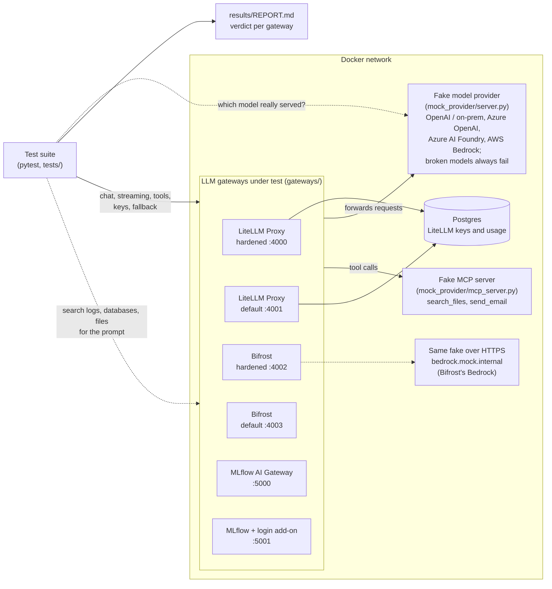

# LLM Gateway Evaluation: LiteLLM vs Bifrost vs MLflow AI Gateway

A hands-on test lab that runs **LiteLLM Proxy**, **Bifrost** and **MLflow AI Gateway** side by side and checks them against the same requirements with automated tests. The goal is to choose a gateway on evidence, not opinion.

**➡️ Full results: [`results/REPORT.md`](results/REPORT.md)**

**➡️ How model routing and connectors work (LiteLLM vs Bifrost): [`docs/ROUTING-AND-CONNECTORS.md`](docs/ROUTING-AND-CONNECTORS.md)**

## Final verdict

| Area (number of graded checks) | LiteLLM Proxy | Bifrost | MLflow AI Gateway |
|---|:-:|:-:|:-:|
| Basic features (5) | ✅ 5/5 | ✅ 5/5 | ✅ 5/5 |
| Fallback (2) | ✅ 2/2 | ✅ 2/2 | ✅ 2/2 |
| No-Retention and cost (3) | ✅ 3/3 | ✅ 3/3 | ⚠️ 2/3 |
| Security (7) | ✅ 7/7 | ✅ 7/7 | ❌ 1/7 |
| **Under load (8)** | ✅ **8/8** | ⚠️ 7/8 | ⚠️ 5/8 |
| **Routing (4)** | ✅ **4/4** | ⚠️ 3/4 | – |
| **Provider connectors: AWS, Azure, Foundry, on-prem (6)** | ✅ 6/6 | ✅ 6/6 | – |
| **Tool connectors, MCP (6)** | ⚠️ 5/6 | ✅ **6/6** | – |
| **All graded checks** | **40 / 41** | **39 / 41** | **15 / 25** |
| Time added, 1 request at a time (p50) | ~9 ms | **~1 ms** | ~12 ms |
| Time added, 100 at once (p50) | ~85–130 ms | **~1 ms** | ~360–420 ms |
| Throughput at 100 at once | ~270–380 req/s | **~660–680 req/s** | ~150–160 req/s |
| Stores prompts with default settings | **No** | Yes | Yes |
| **Verdict** | **Recommended**: safest defaults, exact rate limits, takes failing backends out of rotation, widest provider support | **Strong alternative**: fastest by far, safest MCP auto-run; rate limits overshoot and no automatic cooldown in the free version | **Not suitable** as the gateway: insecure by default, no cost with No-Retention |

Every gateway ran with the **same budget**: 4 CPUs each, and 4 worker processes for the Python gateways (LiteLLM, MLflow). LiteLLM also had Redis, as in production. MLflow was not tested for routing and connectors (– in the table).

### Routing and connectors: what was tested

| Check | LiteLLM | Bifrost |
|---|:-:|:-:|
| 80/20 weighted split across two backends (500 requests) | ✅ 77–81% / 19–23% | ✅ 80–82% / 18–20% |
| Requests asking for the EU always reach the EU backend (100 requests) | ✅ 100/100 | ✅ 100/100 |
| Fallback chain tried in order (broken → broken → working) | ✅ | ✅ |
| **A backend that keeps failing is taken out of rotation** (60 requests) | ✅ **5–6 failed** (cooldown) | ❌ **27–34 failed**: no cooldown in the free version |
| Reaches **AWS Bedrock** (Converse, signed for `eu-central-1`) | ✅ | ✅ |
| Reaches **Azure OpenAI** (EU deployment, API key) | ✅ | ✅ |
| Reaches **Azure AI Foundry** non-OpenAI model (Mistral) | ✅ Foundry inference API | ✅ via Azure's OpenAI v1 API (real Foundry to confirm) |
| Reaches an **on-prem** vLLM server | ✅ | ✅ |
| **Azure EU down → falls back to AWS EU**, never to a US provider | ✅ | ✅ |
| EU Sovereign key can't reach the US Azure deployment | ✅ | ✅ |
| MCP: key without access gets no tools; limited key sees only the safe tool | ✅ | ✅ |
| MCP: risky tool (`send_email`) is handed back, not run, by default | ✅ | ✅ |
| MCP: safe tool runs automatically when switched on | ✅ | ✅ |
| **MCP: risky tool still needs approval when auto-run is on** | ❌ **auto-run covers every tool** | ✅ auto-run is a per-tool list |
| MCP: the connector's secret never reaches caller, model or logs | ✅ | ✅ |

Details and how each works: [`docs/ROUTING-AND-CONNECTORS.md`](docs/ROUTING-AND-CONNECTORS.md).

### Under load: what each feature does with 50–100 requests at once

| Check under load | LiteLLM | Bifrost | MLflow |
|---|:-:|:-:|:-:|
| 200 requests, every caller gets its own answer (none mixed up) | ✅ 200/200 | ✅ 200/200 | ✅ 200/200 |
| 50 streams at once complete correctly | ✅ 50/50 | ✅ 50/50 | ✅ 50/50 |
| 100 requests to a failing model all fall back, never outside the allowed list | ✅ 100/100 | ✅ 100/100 | ✅ 100/100 |
| Limited key: allowed model passes, other model never reaches the provider | ✅ 50/50 + 50/50 | ✅ 50/50 + 50/50 | ❌ no keys |
| **Rate limit 20/min holds under a 60-request burst** | ✅ **20 let through** | ❌ **24–26 let through** | ❌ not available |
| 100 private prompts: none stored (hardened) | ✅ | ✅ | ✅ |
| 100 calls: exactly 100 usage records, correct total cost | ✅ 100/100 | ✅ 100/100 | ❌ no records |
| No errors at 50 and 100 at once (800 requests) | ✅ 0 errors | ✅ 0 errors | ✅ 0 errors |

### What the findings mean

1. **LiteLLM passes every check except one (MCP auto-run covers every tool), including all of them under load.** It also has the safest defaults: it doesn't store prompt text even without hardening.
2. **Bifrost is far faster and almost as complete:**
   - It adds ~1 ms where LiteLLM adds ~10 ms (one at a time) and ~130 ms (100 at once), and it handles about 2.4 times the throughput on the same 4 CPUs.
   - **Its rate limit overshoots under a burst.** A 20/minute limit let 24–26 of 60 simultaneous requests through, on two separate runs. The counter isn't exact when requests arrive at the same moment. Fine for cost control; not for strict quotas.
   - It stores prompts until `disable_content_logging` is switched on, so that setting must be in every deployment.
   - **Keep-alive:** set `keep_alive_timeout_in_seconds` below the provider's idle timeout. With a provider that drops idle connections quickly, Bifrost (with retries off) returned occasional `502` errors on reused connections. Its docs describe this setting for exactly that case.
3. **MLflow can't do No-Retention and cost tracking together.** It works out cost and budgets from its stored request traces, and those traces contain the prompts. It has no per-key rate limits, and it **slows down most under load** (~360 ms added at 100 at once).
4. **MLflow's gateway is open by default.** Without its login add-on, anyone who can reach the server can call models, read the configuration and add provider credentials. The add-on (MLflow + login: 6/7 security checks) fixes most of this, but **any logged-in user can still add provider credentials and destination URLs**.
5. **Corrections made while testing:**
   - **LiteLLM's first rate-limit result (46 of 60) was my misconfiguration.** Redis set only in `router_settings` isn't used for limits across workers; it must also be set with the `REDIS_HOST`/`REDIS_PORT` environment variables. With that, the limit held exactly.
   - **Bifrost's early `502` errors** came from the fake provider's short 5-second keep-alive, now raised to a realistic 65 s.
6. **Routing and connectors:**
   - **Bifrost keeps sending traffic to a failing backend** in the free version (about half the requests failed); taking it out of rotation is the paid circuit breaker. LiteLLM's built-in cooldown handled it.
   - **LiteLLM's MCP auto-run is all or nothing per request.** `require_approval: "never"` also ran the risky `send_email`. Keep risky tools off the key (`mcp_tool_permissions`). Bifrost's auto-run is a per-tool list (`tools_to_auto_execute`), but it applies to every key that can see the tool.
   - **Bifrost setup notes:** `allowed_models: ["*"]` on a virtual key means "models in Bifrost's catalog", so custom deployment names must be listed. Its Bedrock connector reaches private endpoints only through a TLS host name (`endpoints.runtime`); without that it lists models at the public AWS endpoint.
   - **Not settled by fakes:** whether a real Azure AI Foundry resource accepts Bifrost's request for a non-OpenAI model.
7. **Not tested here:** real providers (the fakes prove each gateway sends the right request to the right place, not that real AWS or Azure accept it), provider coverage (LiteLLM 100+ providers, Bifrost ~30), project maturity, and paid-tier features.

## How it works



- **Fake provider** ([`mock_provider/server.py`](mock_provider/server.py)): answers in the API format of AWS Bedrock (Converse), Azure OpenAI, Azure AI Foundry and OpenAI-compatible on-prem servers, and records which API, model and AWS region each request used. A **fake MCP server** ([`mock_provider/mcp_server.py`](mock_provider/mcp_server.py)) records every tool call. It's free and predictable, and it records which model really served each request.
- **Gateways** ([`gateways/`](gateways)): one folder per gateway with its real configuration. All get the same setup: the same models, the same fallback rule (`eu-chat`: broken primary → `backup-model`; `outside-model` is never allowed), and the same hardened settings.
- **No-Retention test:** a unique marker phrase goes into the prompt. Then every container log, the database and every data file is searched byte by byte for it.
- **Speed test:** the timing client runs inside the Docker network ([`scripts/latency_probe.py`](scripts/latency_probe.py)) and alternates direct and gateway calls, so host networking doesn't skew the numbers.
- **Report** ([`scripts/make_report.py`](scripts/make_report.py)): built automatically from the test results.

### Settings tested

| Profile | LiteLLM | Bifrost | MLflow |
|---|---|---|---|
| **Hardened** | `turn_off_message_logging`, `store_prompts_in_spend_logs: false`, `DISABLE_ADMIN_UI=True`, master key | `disable_content_logging`, admin login, `enforce_auth_on_inference`, virtual keys | Endpoint `usage_tracking: false`, own encryption passphrase |
| **Default** | Out-of-the-box (master key only) | Out-of-the-box logging (content stored); login and keys on | Out-of-the-box (`usage_tracking: true`) |
| **Login add-on** | – | – | `--app-name basic-auth`, non-admin user with a role allowed to use only some endpoints |

Pinned images ([`images.json`](images.json)):
- LiteLLM: `ghcr.io/berriai/litellm-database:v1.104.0`
- Bifrost: `maximhq/bifrost:v2.2.6`
- MLflow: `ghcr.io/mlflow/mlflow:v3.17.0`, and `v3.17.0-full` for the login add-on

All are pinned by `sha256` digest.

## Run it yourself

Needs Docker and [uv](https://docs.astral.sh/uv/). The images total about 4.5 GB on first pull.

```bash
uv sync
uv run python scripts/run_eval.py
```

The run takes about 12–15 minutes and ends with a **VERDICT PER GATEWAY** summary (pass count and failed checks for each gateway). It also writes `results/REPORT.md`, plus logs and raw results under `runs/<timestamp>/`.

> Run it through `scripts/run_eval.py`, not `pytest` directly: the script starts the gateways and tells the tests where they are. If you have an older copy, run `git pull` first; Bifrost was added in commit `57926f9`. It also runs on GitHub Actions (**Actions → Evaluate gateways → Run workflow**), and the report appears in the run summary.

The run exits with a non-zero code because MLflow's failures are recorded as failed tests. That's intended: they are findings.

## Limits of this test

- **The provider is fake.** Real Amazon Bedrock, Azure AI Foundry and on-prem servers weren't called, so provider-specific features (prompt caching, guardrails, EU inference profiles, Azure deployments) still need a test with real credentials.
- **Speed was measured on one machine**, with every gateway capped at 4 CPUs (4 workers for LiteLLM and MLflow). Use the numbers to compare the gateways, not to predict production.
- **The No-Retention check covers what each gateway writes itself** (logs, database, data folder). It doesn't cover the provider, or tools you add later such as Langfuse or OpenTelemetry exporters.
- Versions were current as of October 2026. All three projects release often, so re-run the tests after upgrading.
